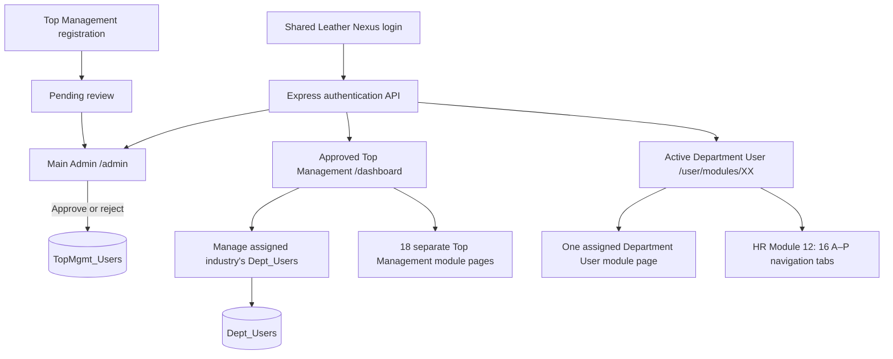

# Leather Nexus

**Industry-oriented data collection, sustainability management, and evidence-readiness portal**  
**Current application baseline: V40 · 3 November 2026**

Leather Nexus is a full-stack web application for managing leather-industry sustainability and compliance information through a controlled, three-level user workflow. A **Main Administrator** approves industry registrations; each approved **Top Management** account manages departmental users for its own industry; each **Department User** signs in to an independent, assigned data-collection workspace.

The application currently provides the user-management foundation, role-based routing and departmental workspace navigation. In particular, the Human Resources module includes a read-only **People & Workplace** evidence-field catalogue with **16 sections (A–P) and 186 fields**. **Questionnaire submissions, evidence-file upload, and persistent responses for those fields are not implemented yet.**

> **Development status:** This repository is a development baseline, not a production-hardened service. Review [Security and deployment notes](#security-and-deployment-notes) before making it publicly accessible.

---

## Contents

- [Project objectives](#project-objectives)
- [Technology stack](#technology-stack)
- [Architecture and account roles](#architecture-and-account-roles)
- [Prerequisites](#prerequisites)
- [Installation from scratch](#installation-from-scratch)
- [Initial account setup and usage](#initial-account-setup-and-usage)
- [Database schema and migrations](#database-schema-and-migrations)
- [Routes and API](#routes-and-api)
- [Eighteen primary modules](#eighteen-primary-modules)
- [Module 12: People & Workplace](#module-12-people--workplace)
- [UI and implemented features](#ui-and-implemented-features)
- [Project structure](#project-structure)
- [Development and verification commands](#development-and-verification-commands)
- [Implementation history through V40](#implementation-history-through-v40)
- [Security and deployment notes](#security-and-deployment-notes)
- [Troubleshooting](#troubleshooting)
- [Publishing to GitHub](#publishing-to-github)
- [Roadmap](#roadmap)

## Project objectives

Leather Nexus was designed to:

1. Provide a central web portal for leather-industry environmental, social, operational, and governance information.
2. Separate **industry registration and approval** from **department-level data entry**.
3. Ensure Top Management can manage only departmental users linked to its registered industry.
4. Route each Department User to exactly one of **18 independent departmental workspaces**.
5. Support consistent, source-defined evidence-field catalogues that can be extended later into validated forms and audit reports.
6. Deliver an accessible, responsive application with consistent branding, navigation, tables, and session-based access control.

## Technology stack

| Layer | Technologies in the current source |
| --- | --- |
| Frontend | React 18, TypeScript, Vite 6, React Router 6 |
| UI / styling | Tailwind CSS 3, custom CSS, Framer Motion, Lucide icons |
| Backend | Node.js, Express 4, TypeScript |
| Database | MySQL, `mysql2` connection pool |
| Authentication | Server-side role checks, bcryptjs for new Top Management/Department passwords, HttpOnly session cookie |
| Supporting packages | `dotenv`, `helmet`, `concurrently`, `tsx` |
| Development utilities | npm workspaces, TypeScript compiler, structure/regression scripts |

This repository consists of two npm workspaces, `frontend` and `backend`, managed from a **single project root**.

## Architecture and account roles



| Role | Account table | Sign-in requirement | Allowed application area |
| --- | --- | --- | --- |
| **Main Admin** | `Main_User` | Valid administrator credentials | `/admin`: approve, reject, review and delete Top Management registrations |
| **Top Management** | `TopMgmt_Users` | Valid credentials and `Approved` status | `/dashboard`, `/users`, `/profile`, `/modules/01`–`/modules/18` |
| **Department User** | `Dept_Users` | Valid credentials, `Active` status and approved industry owner | The single assigned `/user/modules/XX` page |

- All roles use the **same home/login page** (`/`).
- The server maintains the authenticated **User ID, role, industry, assigned department, module ID, and expiration** as session context where applicable.
- Sessions have an **absolute 60-minute lifetime**; activity does not extend it.
- The cookie is **HttpOnly** and uses `SameSite=Strict`. Sessions are stored **in process memory**, not in MySQL.
- Protected pages and corresponding API endpoints both enforce role/department access.

### Industry ownership

`TopMgmt_Users.Industry` is unique in the current schema: **one Top Management registration per industry**. A department user's `Dept_Users.industry` is set by the backend from the authenticated Top Management identity, not from an untrusted browser field.

Changing an industry name updates associated departmental records through the foreign-key relationship. The application revokes the affected departmental sessions so users sign in again. Deleting a Top Management account through Main Admin also deletes associated department accounts for that industry in a single database transaction. **Deletion is permanent; back up before using it.**

## Prerequisites

Install and configure the following on your development computer:

- **Node.js 22 LTS** (recommended for this Vite/TypeScript project), with npm.
- **MySQL Server 8.x** and access to a database user with permissions to create tables, indexes, and foreign keys. The initial bootstrap can also create the `dct` database if the account has permission.
- **Git** for version control and GitHub publishing.
- **Visual Studio Code** or another code editor (optional but recommended).
- A modern browser such as Chrome, Edge, or Firefox.

Check the tools:

```bash
node --version
npm --version
git --version
```

Ensure MySQL Server is running before launching the backend.

## Installation from scratch

### 1. Obtain the project

Clone your own GitHub repository after publishing it:

```bash
git clone https://github.com/YOUR_GITHUB_USERNAME/YOUR_REPO_NAME.git
cd <your-repository>
```

Alternatively, extract the **Leather Nexus V40 complete project archive**, and open its root folder in VS Code. The root folder must contain `package.json`, `frontend/`, `backend/`, and `database/`.

### 2. Install packages in the project root

```bash
npm install
```

**Run this in the root**, not only inside `frontend/`. The root `dev` script starts both the API and the Vite server. Running just the frontend will cause `/api` requests to fail if the backend is not already running.

### 3. Configure MySQL

Start MySQL and make a database backup if you are upgrading an existing installation.

For a **new database**, open `database/schema.sql` in MySQL Workbench and execute it. This script creates the `dct` database and the three account tables. Alternatively, the backend can create the schema at startup when the configured MySQL user has sufficient privileges.

> The schema contains a **development-only Main Admin seed**. Change the initial administrator password before real use. Do **not** add real passwords, `.env` files, or database dumps to GitHub.

### 4. Create the backend environment file

Copy `backend/.env.example` to `backend/.env`.

**Windows PowerShell**:

```powershell
Copy-Item backend/.env.example backend/.env
```

**macOS / Linux / Git Bash**:

```bash
cp backend/.env.example backend/.env
```

Edit `backend/.env` for your local environment:

```dotenv
PORT=5000
CLIENT_URL=http://localhost:5173
DB_HOST=127.0.0.1
DB_PORT=3306
DB_NAME=dct
DB_USER=your_mysql_user
DB_PASSWORD=your_mysql_password
INITIAL_ADMIN_PASSWORD=set_a_private_initial_password
NODE_ENV=development
```

The `INITIAL_ADMIN_PASSWORD` environment variable is used **only when the `Main_User` Admin row is first inserted**. Changing it later does **not** reset an existing administrator account. The current Main Admin credential mechanism is a temporary development implementation; see the security notes below.

`frontend/.env` is **not required** for the normal local setup. Vite already proxies `/api` to `http://127.0.0.1:5000`.

### 5. Start the application

From the **project root**:

```bash
npm run dev
```

The expected local endpoints are:

| Service | URL |
| --- | --- |
| Web application / shared login | http://localhost:5173 |
| Backend API | http://127.0.0.1:5000 |
| API readiness check | http://127.0.0.1:5000/api/health |
| Proxied readiness check | http://localhost:5173/api/health |

The health endpoint returns API status and database readiness information. Check that `database.ready` is `true` before trying to register or sign in.

### 6. If needed, run the two servers separately

Terminal 1:

```bash
npm run dev -w backend
```

Terminal 2:

```bash
npm run dev -w frontend
```

This is useful when debugging connection errors or seeing backend output independently.

## Initial account setup and usage

### A. Main Admin

1. Open `http://localhost:5173`.
2. Sign in using the development administrator account initialized in `Main_User` (set its initial password securely in your local environment before first bootstrap).
3. Open `/admin` to review Top Management registrations.
4. **Approve** or **Reject** pending registrations. You can also review existing accounts in **Table** or **Grid** view.
5. Use **Delete** only after confirming the selected User ID and exact industry; this also deletes that industry's departmental users.

### B. Register Top Management

1. From the shared login page, select **Register Top Management**.
2. Enter **User ID, Password, Industry, Address, and Email**.
3. New registration status is **Pending**, not Approved.
4. A success popup explains that Main Admin approval is required; the page returns automatically to the shared login (the current UI uses a four-second confirmation interval).
5. After Main Admin approval, sign in and open `/dashboard`.

Top Management can now:

- Use the existing **18-module management navigator**.
- View the registered **industry name** at the top of management pages.
- Create, edit, activate/suspend, and delete **department users** belonging only to that industry.
- Edit its own **Industry, Address, Email, and optionally Password** at `/profile`, after providing the current password. **User ID, role, and approval status cannot be edited** from the profile.

### C. Create Department Users

1. Sign in with an **Approved Top Management** account.
2. Open **Users** at `/users` and select **Add User**.
3. Provide **User ID, name, email, department/module, and password**.
4. The backend automatically assigns the industry from the Top Management session.
5. The new department user signs in at the **same login page** and is redirected to the assigned `/user/modules/XX` page.

Suspended departmental accounts cannot access their module. Departmental users cannot open another department's module or any Top Management route merely by changing the URL.

### Account validation

New and changed Top Management/Department passwords must:

| Rule | Requirement |
| --- | --- |
| Length | 8–15 characters |
| Uppercase | At least one `A–Z` |
| Lowercase | At least one `a–z` |
| Number | At least one `0–9` |
| Special character | At least one of `#`, `@`, `_`, `$` |
| Allowed characters | Letters, digits and **only** those four special characters |

Both account-creation forms include a live validation checklist. The backend validates the policy again. Existing accounts may sign in with previously saved credentials even if they predate the new policy.

The application checks **User ID uniqueness** in the relevant account table and also prevents conflicting IDs across roles because the login page is shared. Top Management registration additionally checks for an existing **industry** and duplicate **email**, with a unique database index protecting against concurrent duplicates.

## Database schema and migrations

The canonical new-install schema is [`database/schema.sql`](database/schema.sql).

### Main account tables

**`Main_User`** — Main Administrator

| Column | Description |
| --- | --- |
| `Userid` | Primary key |
| `Password` | Development administrator password; must be hardened before production |

**`TopMgmt_Users`** — Registered industry leadership

| Column | Description |
| --- | --- |
| `UserID` | Primary key, not editable through profile |
| `password` | bcrypt hash for new registrations |
| `Industry` | Registered industry name; unique; used to identify department ownership |
| `Address` | Registered address |
| `Email` | Validated email; unique |
| `role` | Defaults to `Top Management` |
| `status` | `Pending`, `Approved`, or `Rejected` |

**`Dept_Users`** — Department personnel

| Column | Description |
| --- | --- |
| `UserID` | Primary key |
| `password` | Password hash for new/changed credentials |
| `name` | Department user's display name |
| `department` | Assigned module/department title |
| `industry` | Owner industry set by the authenticated backend; indexed foreign key |
| `emailid` | User email address |
| `created_time` | Creation timestamp |
| `status` | `Active` or `Suspended` |

The `Dept_Users.industry` foreign key references `TopMgmt_Users.Industry` with **`ON UPDATE CASCADE`** and **`ON DELETE RESTRICT`**. Main Admin deletion first removes associated department users and then removes the Top Management account in a single transaction.

### Fresh installation versus an older database

- **Fresh V40 database:** use `database/schema.sql` or the backend initialization; `TopMgmt_Users.Email` already exists as a required, unique column.
- **Database from V36 or earlier:** back up first, then run [`database/alter_topmgmt_email_v37.sql`](database/alter_topmgmt_email_v37.sql) **once** to add nullable `Email` and a unique index. Supply verified, unique email addresses for old accounts before optionally making this column `NOT NULL`.
- **Legacy V30 or earlier:** read [`MIGRATION_V31.md`](MIGRATION_V31.md). Old `Main_Login` and `users` tables are **not automatically migrated or deleted**, since their industry ownership cannot be inferred. See `database/manual-legacy-migration-template.sql` for a manually reviewed mapping workflow.
- **V38–V40 updates:** no additional SQL schema migration is required after the standard V37 email migration.

**Never run a migration blindly against live data.** Review existing columns, foreign keys, unique constraints and backups before executing it.

## Routes and API

### Frontend pages

| URL | Who can access it | Function |
| --- | --- | --- |
| `/` | Public | Shared login |
| `/register/top-management` | Public | Top Management registration |
| `/admin` | Main Admin | Approval, rejection, listing, deletion |
| `/dashboard` | Top Management | Searchable 18-module navigator |
| `/users` | Top Management | Department User CRUD |
| `/profile` | Top Management | My Profile / Edit Details |
| `/modules/01` … `/modules/18` | Top Management | 18 separate management workspaces |
| `/user/modules/01` … `/user/modules/18` | Department User | 18 separate departmental workspaces, one assigned page per account |
| `/user/modules/12?section=A` … `?section=P` | Assigned Department User for Module 12 | Select a People & Workplace section |

### Backend endpoints

| Endpoint | Method(s) | Purpose |
| --- | --- | --- |
| `/api/health` | `GET` | API / database readiness |
| `/api/auth/login`, `/api/auth/logout`, `/api/auth/me` | `POST`, `POST`, `GET` | Login, logout, session inspection |
| `/api/register` | `POST` | Create pending Top Management account |
| `/api/register/check-user-id` | `GET` | Check management User ID availability |
| `/api/register/check-email` | `GET` | Check management email availability |
| `/api/admin/registrations` | `GET` | Main Admin registration list |
| `/api/admin/registrations/:userId/status` | `PATCH` | Approve/reject management registration |
| `/api/admin/registrations/:userId` | `DELETE` | Confirmed industry-account deletion and departmental cascade |
| `/api/users` | `GET`, `POST` | Industry-scoped department list / creation |
| `/api/users/check-user-id` | `GET` | Department User ID availability |
| `/api/users/:userId` | `PUT`, `DELETE` | Edit/delete industry-scoped user |
| `/api/users/:userId/status` | `PATCH` | Activate/suspend user |
| `/api/top-management/profile` | `GET`, `PUT` | Read/update own Top Management profile |
| `/api/top-management/profile/check-email` | `GET` | Check profile email availability |
| `/api/modules`, `/api/modules/:id` | `GET` | Top Management module metadata |
| `/api/department/modules/:id` | `GET` | Assigned departmental module metadata |

> Endpoints are not a substitute for permissions: the Express API applies authentication and role/industry/department checks. Request bodies and session cookies are required for protected operations. See `backend/src/` for the authoritative API implementation.

## Eighteen primary modules

The Top Management navigator provides all 18 modules. Department Users have **separate files and routes** for their assigned module; they do not reuse the management workspaces.

| No. | Module |
| --- | --- |
| 01 | Organisation, Governance & Policy |
| 02 | Legal & Regulatory Compliance |
| 03 | Production, Process & Operational Baseline |
| 04 | Raw Material Traceability & Supplier Origin |
| 05 | Energy Management & Utilities |
| 06 | Carbon Footprint & GHG Inventory |
| 07 | Water, Wastewater, ZLD & CETP |
| 08 | Chemical Management & Restricted Substances |
| 09 | Solid Waste, Hazardous Waste & Circularity |
| 10 | Air Emissions, Odour, Noise & Local Environment |
| 11 | Occupational Health & Safety |
| 12 | Human Resources, Labour & Social Compliance |
| 13 | Product Quality, Safety & Customer Compliance |
| 14 | Procurement, Suppliers & Contractors |
| 15 | Risk, Opportunity & Materiality |
| 16 | Objectives, Targets, KPIs & Sustainability Index |
| 17 | Evidence Repository & Audit Trail |
| 18 | Gap Analysis, CAPA & Continual Improvement |

## Module 12: People & Workplace

The **Department User Module 12** page includes a horizontal, scrollable submodule navigation based on the *Leather Nexus Common Evidence Database — People & Workplace* specification (document `LN-PW-CED-001`, Version 1.0, 25 August 2026).

| Section | Exact source domain | Fields |
| --- | --- | ---: |
| A | Facility & Workforce Profile | 15 |
| B | HR Governance, Policies & Legal Compliance | 15 |
| C | Recruitment, Hiring, Age & Employment Eligibility | 12 |
| D | Employment Terms, Contracts & Forced-Labour Safeguards | 10 |
| E | Working Hours, Overtime, Rest & Leave | 12 |
| F | Wages, Benefits, Social Security & Payroll Integrity | 13 |
| G | Equality, Non-Discrimination, Harassment & Discipline | 11 |
| H | Freedom of Association, Collective Bargaining & Worker Voice | 10 |
| I | Grievance, Complaints, Remedy & Whistleblowing | 10 |
| J | Competence, Training, Awareness & Development | 12 |
| K | Workplace Environment, Welfare & Employee Experience | 16 |
| L | Occupational Health & Safety – People Interface | 14 |
| M | Termination, Retrenchment & Separation | 6 |
| N | Worker Privacy & Personal Data Protection | 8 |
| O | People Metrics, Monitoring, Audit & Continual Improvement | 14 |
| P | Contractors, Labour Agencies & On-site Service Providers | 8 |
| **Total** | **16 sections** | **186** |

Each tab updates the query string (`?section=A` through `?section=P`) and displays a **read-only master-field preview** including permanent IDs (`PW-A001` and onward), field description, input type, requirement level, privacy class, update frequency, risk, and field-specific evidence guidance.

The previous two auxiliary panels—**Future Data Entry Forms** and **Official Evidence Framework**—were removed in V36. The current screen is intentionally a streamlined, full-width evidence-field catalogue.

**Not yet implemented:** saving HR answers, uploading evidence, document expiry reminders, cross-standard audit mapping, approval of submitted evidence, or PDF report generation. Other departmental workspaces remain extension points for future module-specific fields.

## UI and implemented features

- **Branding:** text-only *Leather Nexus* wordmark in a stylized serif font; ivory and champagne-gold colors over a full-width forest-green gradient header. The header icon and experimental floating/glass scroll state were removed.
- **Shared footer:** fixed, compact **42 px** dark-green gradient footer.
- **Top Management layout:** fixed left sidebar between header and footer; desktop width **238 px**, narrower width **78 px**; independent sidebar scrolling on short displays.
- **Navigator:** 18 uniquely colored cards, searchable module list, grid/list display options, and direct module navigation.
- **Users overview:** indigo/blue **Total**, teal/green **Active**, amber/orange **Suspended** summary cards.
- **User Directory:** centered table headers and cells (V40), user avatars and badges, department names with wrapping, search, status filters, sorting, pagination and colored account actions.
- **User modal:** compact, responsive Add/Edit dialog with controlled backdrop, accessible focus handling, and a two-step flow on small screens.
- **Password UI:** reusable live requirements checklist and progress indicator for registration, user creation, and password changes.
- **Main Admin:** searchable registrations, four status summary cards, centered Table view, responsive Grid view, status filter, Approve/Reject/Delete actions and impacted-department-user count.
- **Top Management profile:** editable industry, address and unique email; optional password change, current-password verification, locked User ID.
- **Department user layout:** separate workspace design; signed-in user's name and ID displayed near **Sign out**.

## Project structure

```text
leather-nexus/
├── .gitignore
├── package.json                   # npm workspaces and shared commands
├── README.md                      # this guide
├── CHANGELOG_V*.md                # version history (available versions)
├── MIGRATION_V31.md
├── database/
│   ├── schema.sql
│   ├── alter_topmgmt_email_v37.sql
│   └── manual-legacy-migration-template.sql
├── backend/
│   ├── .env.example
│   ├── package.json
│   ├── tsconfig.json
│   └── src/
│       ├── server.ts
│       ├── config/db.ts
│       ├── auth/                 # login, session, validation, permission helpers
│       └── routes/               # admin, registration, users, profile, modules
├── frontend/
│   ├── .env.example
│   ├── index.html
│   ├── package.json
│   ├── vite.config.ts
│   ├── tailwind.config.js
│   └── src/
│       ├── App.tsx
│       ├── auth/
│       ├── layouts/             # common, management, department
│       ├── components/          # navigation, modal, HR catalogue, etc.
│       ├── data/                # module metadata, People & Workplace field data
│       ├── pages/
│       │   ├── MainAdminPage.tsx
│       │   ├── TopManagementRegistrationPage.tsx
│       │   ├── TopManagementProfilePage.tsx
│       │   ├── UsersPage.tsx
│       │   ├── modules/         # Module01Page–Module18Page: Top Management
│       │   └── user-modules/    # UserModule01Page–UserModule18Page: Department Users
│       ├── services/api.ts
│       └── index.css
└── tests/
    ├── verify-v31.mjs
    ├── verify-v32.mjs
    ├── verify-v37.mjs
    └── verify-v38.mjs
```

## Development and verification commands

Run from the **root**:

```bash
npm install              # install both workspaces
npm run dev              # run frontend and backend together
npm run build            # compile the API and build the Vite frontend
npm run check:structure  # source-level V32 architecture assertions
npm run check:v37        # V37 regression checks
npm run check:v38        # V38 regression checks
```

The repository also includes `tests/verify-v31.mjs`, which you can run directly:

```bash
node tests/verify-v31.mjs
```

Build the workspaces independently when debugging:

```bash
npm run build -w backend
npm run build -w frontend
```

The current scripts primarily cover **source-level structure and regression assertions**. They are **not a replacement** for database migration testing, unit tests, browser end-to-end tests, security testing, or production deployment verification.

## Implementation history through V40

The project evolved from a JSP-based Top Management navigation concept into a modular React/Express application. Relevant milestones in the available history:

| Version | Delivered change |
| --- | --- |
| **Initial / V15** | React + Node.js DCT portal, login, management modules, MySQL user administration and temporary authentication workflow |
| **V16–V18** | Improved Add/Edit User modal: full-screen backdrop, focus controls, compact/no-scroll responsive layout |
| **V19–V20** | Searchable 18-module Top Management launchpad, grid/list layout and unique module colors |
| **V21** | Fixed shared footer and layout spacing |
| **V22** | Experimental floating/blurred header (**subsequently removed**) |
| **V23** | User Management statistics, table styling, search/filter/sort/pagination |
| **V24** | Restored full-width header; shortened fixed footer to 42 px |
| **V25–V27** | Leather Nexus serif wordmark, department badge wrapping, temporary emblem (**emblem subsequently removed**) |
| **V28** | Unified login for management and departmental accounts |
| **V29** | Split management and departmental module pages into **18 + 18** independent routes/components |
| **V30** | Moved Department User identity into the top bar beside Sign out |
| **V31** | Introduced **Main Admin**, `TopMgmt_Users`, `Dept_Users`, registration/approval, industry ownership and three-role sessions |
| **V32** | Registration success popup, password policy, duplicate User ID checks and management industry banner |
| **V33** | Live per-rule password checklist and progress indicator |
| **V34** | First HR submodule navigation (18 groups from a 90-question questionnaire) |
| **V35** | Replaced HR groups with **16 official A–P sections / 186 source fields** |
| **V36** | Removed auxiliary HR panels; retained full-width field list |
| **V37** | Enhanced Admin Table/Grid views; added validated, unique Top Management email and migration SQL |
| **V38** | Top Management profile editing; Admin account deletion with related department-user deletion in a transaction |
| **V39** | Fixed Top Management sidebar |
| **V40 — Current** | Centered Top Management Users table headers and all body cells; kept department wrapping and existing actions |

Individual details are available in the corresponding `CHANGELOG_V*.md` files present in the repository. Intermediate version numbers without a changelog are not claimed as standalone releases here.

## Security and deployment notes

**Do not deploy the current code publicly without additional hardening.** Current limitations and minimum recommendations:

1. **Main Admin credential:** The initial administrator record is seeded with a development password and may be stored as plain text. Replace this with a securely hashed password flow and a secure, single-use initialization process. Never commit working credentials.
2. **Session storage:** Sessions and some rate-limit counters are held in process memory. A process restart invalidates sessions; multiple API instances will not share them. Use a persistent, centralized session and throttling store for real deployment.
3. **HTTPS and cookie configuration:** Deploy behind HTTPS with properly configured secure cookies, reverse-proxy trust settings and CSRF protections suited to the deployment topology.
4. **Input/file safety:** Implement thorough server-side validation, audit logging, file scanning, upload limits and protected storage **before** adding evidence uploads or handling confidential worker documents.
5. **Data privacy:** People & Workplace can refer to confidential HR information. Favor aggregate/anonymized records and enforce purpose limitation, access logging, retention and deletion requirements.
6. **Deletion and migrations:** Back up before Admin deletion and schema changes; review any additional table dependencies or other systems that use industry records.
7. **Account protection:** Add verified email ownership, password reset, robust account recovery, persistent rate limiting, and monitoring before production deployment.
8. **Testing:** Complete backend API integration tests, MySQL transaction tests, browser role-navigation tests and authorization/security reviews.
9. **Source control:** Do not commit `backend/.env`, database dumps, private employee data, production secrets, or `node_modules`. Review `.env.example` and replace illustrative passwords before publishing a public repository.
10. **Release/licensing:** No open-source license is declared in the current source; add an explicit `LICENSE` only if you intend to authorize public reuse.

## Troubleshooting

| Symptom | Check / fix |
| --- | --- |
| `ECONNREFUSED 127.0.0.1:5000` | Start the backend. Use `npm run dev` **from the root** so both workspaces run. |
| Database connection fails | Start MySQL; verify `DB_HOST`, `DB_PORT`, `DB_USER`, `DB_PASSWORD`, `DB_NAME` in `backend/.env`. |
| `/api/health` reports database not ready | Read backend logs; check the database user has privileges and the schema/migrations are complete. |
| `TopMgmt_Users.Email is missing` or unique index error | Back up and run the one-time V37 email migration on an older database. |
| Top Management cannot sign in | Registration may still be Pending or Rejected; Main Admin must Approve it. Also verify credentials. |
| Department User cannot open a module | Check `Dept_Users.status`, assigned `department`, associated industry, and Top Management approval. |
| Department user sees no other modules | This is intentional: a Department User can access **only their assigned workspace**. |
| Login stops working after an hour | Expected: sessions expire after an absolute 60 minutes; sign in again. |
| Session ends after server restart | Expected with the current in-memory session store. |
| User creation fails with duplicate ID/email/industry | Check for an existing record; the API and database enforce relevant uniqueness rules. |
| Styles/layout do not update | Hard-refresh the browser or restart the frontend after replacing files. |
| Port 5173 or 5000 is occupied | Stop the conflicting process or adjust and synchronize Vite proxy/server settings. |

## Publishing to GitHub

Before uploading:

1. Ensure that the project root contains this file as **`README.md`**.
2. Keep `backend/.env` private, inspect staged files for passwords, and remove any real employee/customer data or database dumps.
3. Commit only source code, documentation and intentionally public example configuration.

For a new repository:

```bash
git init
git add .
git status             # inspect staged files for secrets before committing
git commit -m "Document Leather Nexus V40 setup and features"
git branch -M main
git remote add origin https://github.com/YOUR_GITHUB_USERNAME/YOUR_REPO_NAME.git
git push -u origin main
```

Replace the placeholder repository URL with the actual **empty repository URL that you created on GitHub**. If the project is already a Git repository, simply replace its root `README.md`, inspect the diff, then commit and push the change instead of running `git init` again.

---

## Roadmap

- [ ] Implement answer/input forms for the 186 People & Workplace fields in Module 12.
- [ ] Add privacy-aware evidence upload, document versioning and controlled access.
- [ ] Add conditional questions, mandatory checks, review workflow and draft/submission status.
- [ ] Link source field IDs to configurable standard mappings and applicable law layers.
- [ ] Implement MySQL persistence for departmental answers, audit metadata and KPI records.
- [ ] Build department completion dashboards and management review/approval workflows.
- [ ] Add verified email, stronger Main Admin authentication, password reset and production session storage.
- [ ] Add automated backend, database transaction, security and browser end-to-end tests.
- [ ] Develop the other 17 departmental submodule catalogues and data-entry workflows.
- [ ] Add reporting/export functionality once the supporting data and audit logic exist.

---

**Leather Nexus — current documented baseline: V40.**  
*README reflects the provided V40 source package and its version history; future features are explicitly identified as planned rather than implemented.*
